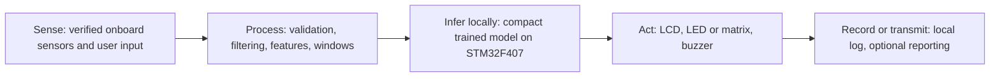

# Task 1 — Product Concept and Design

## Product concept

The Smart Storage Indicator is an experimental monitor for people storing household goods that can be affected by heat, humidity, light, or frequent access; it periodically measures temperature, relative humidity, ambient light, and proximity around a storage container, combines these readings into locally classified storage conditions, and presents an understandable status through the board display, LEDs, buzzer, and serial record so that a user can investigate exposure sooner, with the goal of making storage conditions visible without relying on a network service.

## Alternative concepts

| Concept | Purpose | Selection rationale |
|---|---|---|
| Context-Aware Study Desk | Detects desk occupancy and environmental conditions to adjust study reminders or lighting. | Useful, but its expected benefit depends more on activity recognition and room context than on the available environmental sensor set. |
| Household Object-Handling Monitor | Uses proximity and motion to indicate when a stored or frequently handled object is moved. | The IMU and proximity sensor could support it, but it would not directly communicate storage environment exposure. |
| **Smart Storage Indicator (selected)** | Classifies storage exposure conditions from temperature, humidity, light, and access cues. | Directly uses the AHT10 and AP3216C primary sensing modalities, supports actionable local feedback, and allows controlled, measurable state definitions. |

## Classification states

These are prototype operational labels, not food-safety or product-preservation guarantees. Thresholds are provisional and must be calibrated to the intended stored item and supported by collected training data before use.

| State | Meaning | Prototype evidence / response |
|---|---|---|
| 0 — Sealed & Safe-Range Storage | Recent environmental readings remain within configured limits and no access cue is observed. “Safe-range” means only within prototype thresholds. | Green/normal indication; record window and confidence. |
| 1 — Active Access / Door Open | Proximity or light changes indicate likely access, or readings show a short access-related transition. | Amber indication; optional brief acknowledged tone; begin an access event record. |
| 2 — Adverse Exposure Risk | Sustained temperature, humidity, or light readings cross configured exposure thresholds. | Red indication and audible alert subject to acknowledgement; show which measured condition triggered the alert. |
| 3 — Sensor / System Fault | Required readings are invalid, stale, or unavailable, or required initialization fails. | Distinct fault indication; never silently report normal storage. |

## System architecture

The diagram describes the intended pipeline. Peripheral bus and GPIO assignments remain unconfirmed pending the RT-Spark schematic/pinout.

## Component-to-function matrix

Inventory below distinguishes requested/expected components from components confirmed in repository evidence. No board schematic, manifest, or hardware inventory was present at the time of writing; physical presence, pin assignments, and interfaces therefore require board-side confirmation.

| Component | Intended function category | Intended use | Repository verification |
|---|---|---|---|
| AHT10 | Primary sensing | Temperature (°C), relative humidity (%RH) | Not verified |
| AP3216C | Primary sensing | Ambient light and proximity/IR counts | Not verified |
| ICM20608 | Context sensing; diagnostic/service use | Motion and orientation context | Not verified |
| LCD | User interaction / output | Status and diagnostic messages | Not verified |
| LED / LED matrix | User interaction / output | State and fault indication | Not verified |
| Buzzer | User interaction / output | Acknowledgable warning tone | Not verified |
| Push buttons | User interaction | Acknowledge, reset, calibrate, mode selection | Not verified |
| RTC | Logging/communication; diagnostic/service use | Timestamp records | Not verified |
| External flash | Logging/communication; diagnostic/service use | Local records/model storage if supported | Not verified |
| microSD / TF | Logging/communication; diagnostic/service use | Removable local records if supported | Not verified |
| Wi-Fi module | Logging/communication; diagnostic/service use | Optional status/telemetry only | Not verified |
| UART / USB | Logging/communication; diagnostic/service use | Console, capture, service connection | Not verified |
| IR, CAN, RS485 interfaces | Diagnostic/service use | Board-specific service interfaces if fitted | Not verified |

## Acceptance criteria and measurement plan

- In normal operation, valid sensor windows produce one of the defined local states, and each state updates the available display/LED feedback. Missing or invalid required input produces State 3 rather than a normal indication.
- A controlled environmental/access sequence must exercise all configured states. Evaluate with at least 30 training windows and 10 separate-session held-out windows per class, then 20 independent product trials per class after tuning.
- Report the confusion matrix, per-class precision and recall, false-negative and false-positive counts, capture-to-response latency, at least 50 on-device inference timings, memory footprint, a 15-minute continuous run, and a 5-minute offline run. Hardware results remain pending actual board execution and must not be estimated or fabricated.
- False negatives for adverse exposure can delay a user's response; false positives can cause alert fatigue. State 0 is not a guarantee that stored contents are safe.
- Privacy risk is low for environmental-only telemetry but rises if logs include timestamps or user activity; retain only necessary local data and avoid identifying user records. Accessibility requires distinguishable visual and audible/haptic-independent status cues, readable text, and alert acknowledgement. Buzzer volume and alert behavior must not create a startle or hearing risk.
- This is an experimental prototype and is not certified for food, medicine, or other safety-critical storage decisions.

## Hardware verification gate

Before any sensor or UI driver is wired to GPIO/I2C/SPI/UART, provide or confirm the RT-Spark (Spark-1) schematic or verified pin mapping for AHT10, AP3216C, ICM20608, LCD, buttons, LEDs, buzzer, RTC, storage, and communication modules. No pin mapping is inferred from a generic STM32F407 board.
